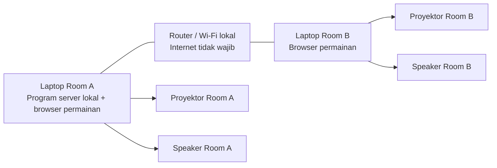

# Rencana D-Day: dua ruangan, satu permainan

Tanggal: 12 Oktober 2026.

Nomor **1 (sesi bersama)** dan **3 (pemulihan progres)** sudah diimplementasikan melalui server lokal. Mode GM/viewer, ranking, hosting online, dan failover otomatis belum dibuat. Cara operasional singkat ada di [OPERATE-2-DEVICE-LOCAL.md](OPERATE-2-DEVICE-LOCAL.md). Rehearsal dengan perangkat fisik kedua ruangan masih diperlukan.

## Kebutuhan yang sudah diketahui

- Room A dan Room B menggunakan dua laptop/perangkat yang berbeda.
- Kedua laptop boleh menggunakan Windows atau Mac, termasuk kombinasi keduanya. Launcher Windows tersedia melalui `SETUP-WINDOWS.cmd` dan `START-WINDOWS.cmd`.
- Setiap ruangan mempunyai proyektor dan sistem speaker sendiri.
- Kedua ruangan perlu mengikuti permainan yang sama: fase, countdown, dan hasil undian faction.
- Tampilan permainan yang ada tetap menjadi dasar. Pemisahan tampilan GM dan viewer bukan kebutuhan wajib saat ini.
- Ranking setelah setiap Exchange masih dalam tahap perencanaan. Layar peserta hanya menampilkan peringkat, tanpa angka poin.

## 1. Arti satu sesi permainan bersama

Satu sesi berarti kedua laptop membaca keadaan permainan yang sama. Contoh perilaku yang dituju:

- Operator menjalankan Terawang 1; countdown pada kedua layar mengikuti waktu mulai dan selesai yang sama.
- Operator mengacak target Exchange 1; susunan target pada kedua layar sama persis.
- Pause, lanjut, reset, dan perubahan fase diterapkan pada sesi tersebut, kemudian diperbarui pada kedua layar.
- Refresh pada salah satu laptop mengambil kembali sesi yang sedang berjalan, bukan membuat undian baru.

Mode mandiri masih memakai `localStorage` pada masing-masing browser. Untuk sesi bersama, jalankan `npm run host` dan buka alamat jaringan server yang sama di kedua laptop; membuka dua aplikasi mandiri tidak menyatukan data.

Server kini menyimpan keadaan permainan dan mengirim pembaruan ke kedua browser melalui Server-Sent Events. Hasil undian ditetapkan satu kali untuk setiap Exchange dan disimpan sebelum animasi dimulai. Browser memakai kembali hasil tersebut ketika bergabung atau tersambung kembali.

| Mengikuti sesi bersama | Tetap di perangkat masing-masing |
| --- | --- |
| Fase dan nomor Exchange | Fullscreen dan sambungan proyektor |
| Status mulai, pause, dan reset | Volume serta mute speaker |
| Waktu mulai/selesai countdown | Aktivasi izin suara browser |
| Hasil undian yang sudah ditetapkan | Pilihan output audio pada sistem laptop |
| Waktu mulai presentasi roulette dan reveal | Pengaturan tampilan lokal yang tidak mengubah permainan |

Countdown dihitung dari waktu selesai yang dibagikan server, dengan penyesuaian terhadap waktu server. Angka tiap detik tidak bergantung pada kiriman jaringan terus-menerus. Durasi rundown, jeda reveal, dan aturan undian yang ada dipertahankan.

## 2. Mode GM dan viewer bersifat opsional

Untuk tahap awal, kedua laptop boleh tetap memakai tampilan dan kontrol yang sekarang. Tidak harus membuat halaman viewer terpisah atau sistem akun.

Usulan operasional: tentukan satu operator aktif untuk perintah yang memengaruhi permainan bersama. Operator ruangan lain mengurus fullscreen dan speaker lokal. Jika kendali dialihkan, kedua operator berkoordinasi agar tidak menekan perintah global bersamaan. Server tetap perlu menolak perintah yang sudah kedaluwarsa atau duplikat agar dua klik tidak mengubah fase dua kali.

Mode viewer tanpa tombol bisa dipertimbangkan nanti bila diperlukan. Pengembangan ranking juga tidak otomatis mewajibkan pemisahan GM/viewer untuk seluruh aplikasi. Jika kelak input poin dilakukan di aplikasi, pengaturan input yang tidak ditampilkan pada proyektor perlu direncanakan tersendiri.

## 3. Pemulihan koneksi dan penyimpanan progres

Perilaku yang sudah dibuat:

- Keadaan fase, countdown, dan target tersimpan pada server sehingga browser kedua dapat mengambil keadaan terbaru.
- Setelah refresh atau koneksi Wi-Fi pulih, perangkat tersambung kembali ke sesi yang sama.
- Selama koneksi terputus, layar menandai bahwa keadaan yang ditampilkan belum menerima pembaruan. Estimasi countdown dapat berjalan dari waktu selesai terakhir, tetapi perubahan oleh operator lain baru diketahui setelah koneksi pulih.
- Perintah yang memerlukan sesi bersama tidak diterapkan secara lokal saat server tidak dapat dijangkau.
- Sambung kembali tidak mengacak ulang hasil atau memutar ulang pengumuman fase yang sudah lewat.
- Server menyimpan progres ke penyimpanan lokal agar restart program dapat memulihkan sesi. Waktu yang telah berlalu tetap diperhitungkan; fase berikutnya mengikuti kendali GM sesuai aturan aplikasi saat ini.

Server menyimpan progres secara atomik ke `.game-state/session.json`. Restart dengan `npm start` memakai fase, hasil undian, serta deadline yang sama. File yang rusak tidak ditimpa atau diganti dengan permainan baru secara diam-diam.

Pemindahan server dari laptop A ke laptop B merupakan kebutuhan backup yang berbeda. Bila fitur ini diperlukan, harus disediakan salinan progres dan prosedur pemulihan pada server pengganti. Jangan menganggap salinan aplikasi saja otomatis membawa fase dan hasil undian terakhir. Pemindahan tersebut direncanakan manual dahulu; failover otomatis belum menjadi keputusan.

## 4. Server lokal, hosting online, dan backup

Server adalah program, bukan perangkat ketiga yang wajib dibeli. Usulan setup memakai dua laptop yang sudah diperlukan untuk dua ruangan:

Program server bisa dijalankan di laptop Room A atau Room B. Kedua laptop membuka sesi yang sama melalui alamat jaringan laptop server. Laptop server dapat menjalankan browser untuk proyektor dan speaker ruangannya pada waktu yang sama.

Server dan router harus tetap menyala selama permainan. Jaringan harus mengizinkan koneksi antarperangkat dan menjangkau kedua ruangan. `npm run host` mendengarkan pada `0.0.0.0:3000` dan mencetak alamat LAN. `npm run dev` tetap hanya untuk development pada satu laptop.

Untuk D-Day di satu lokasi, server lokal diusulkan sebagai jalur utama agar permainan tidak bergantung pada internet. Hosting online merupakan pilihan terpisah untuk akses dari luar jaringan venue. Hosting frontend saja belum menyediakan sesi bersama; backend sinkronisasi tetap diperlukan jika versi online juga digunakan untuk permainan bersama.

Backup berarti menyediakan salinan aplikasi dan, bila ingin melanjutkan sesi yang sama, salinan progres serta cara memulihkannya. Dengan demikian server lokal bisa menjadi sistem utama, tidak harus hanya disebut backup.

Pilihan server cadangan gratis pada laptop B, perkiraan biaya online, serta langkah persiapan Railway dicatat singkat di [BACKUP-ONLINE.md](BACKUP-ONLINE.md). Salinan online belum otomatis mengikuti progres server lokal.

## Dua sistem speaker tetap bekerja sendiri-sendiri

Setiap browser memutar file audio melalui laptopnya sendiri: laptop A ke speaker A, laptop B ke speaker B. Server mengirim peristiwa fase dan waktu pemutaran, bukan mengalirkan suara laptop A ke speaker B.

Sebelum permainan, operator masing-masing ruangan mengaktifkan suara pada browser, mencoba cue, dan memastikan output audio menuju speaker yang benar. Volume dan mute tetap dapat diatur terpisah. Setelah refresh, browser mungkin perlu aktivasi suara lagi.

Sinkronisasi memakai waktu peristiwa yang sama, tetapi ketepatan suara nyata perlu diuji dengan kedua sistem speaker. Latensi browser dan perangkat audio dapat berbeda; rencana ini tidak menjanjikan pemutaran yang identik pada setiap sampel audio.

## Rencana berikutnya: ranking tanpa angka poin

Status: perencanaan, belum menjadi perubahan pada layar permainan.

Kebutuhan tampilan yang dicatat:

- Setelah setiap Exchange lengkap, tersedia tampilan peringkat faction.
- Layar menampilkan urutan/peringkat, nama faction, dan logo.
- Angka poin, perubahan poin, serta rincian perhitungan tidak ditampilkan pada proyektor.
- Jika digunakan pada sesi bersama, kedua ruangan mengambil pembaruan ranking yang sama.

Usulan waktu tampil adalah setelah Exchange 1, setelah keseluruhan Exchange 2 selesai, dan setelah Exchange 3. Bagian Gambler pada Exchange 2 tidak mengubah poin berdasarkan aturan sekarang, sehingga bukan jeda ranking tambahan pada usulan awal. Operator mengonfirmasi ranking siap sebelum ditampilkan; ranking tidak perlu menambah countdown baru. Hubungannya dengan layar Permainan Selesai setelah Exchange 3 masih perlu diputuskan.

Keputusan yang masih terbuka:

| Keputusan | Pilihan yang perlu ditentukan |
| --- | --- |
| Sumber ranking | Operator memasukkan urutan secara manual, atau aplikasi menghitung dari input poin yang hanya ada pada sisi pengelola |
| Lingkup ranking | Gabungan Room A dan Room B, atau per ruangan |
| Peringkat seri | Cara menampilkan faction dengan kedudukan yang sama, tanpa membuat pemisah seri yang belum disepakati |
| Pemicu tampilan | Konfirmasi operator, atau otomatis setelah data hasil Exchange sudah lengkap |
| Lama tampilan | Sampai operator melanjutkan, atau durasi tertentu di luar timer aktif |
| Ranking terakhir | Ditampilkan sebelum layar selesai, atau menjadi bagian dari pengumuman pemenang |

Jika ranking dihitung dari poin, tampilan peserta cukup menerima data peringkat. Input poin dan perhitungan diletakkan pada sisi pengelola. Jika urutan dimasukkan manual, belum perlu membuat sistem pencatatan poin pada aplikasi.

## Status pengerjaan

1. Satu server lokal dan dua browser dengan UI sekarang: sudah dibuat.
2. Sinkronisasi fase, countdown, undian, animasi, dan cue lokal: sudah dibuat.
3. Penyimpanan progres dan reconnect: sudah dibuat; tes mencakup dua koneksi, restart saat undian/countdown, sisa waktu, serta perintah duplikat/kedaluwarsa.
4. Rehearsal dengan dua laptop, dua proyektor, dua speaker, dan jaringan venue: langkah berikutnya di lokasi.
5. Hosting online dan pemisahan GM/viewer: belum diperlukan pada tahap ini.
6. Ranking: menunggu keputusan perencanaan di atas.

Verifikasi lokal: build TypeScript dan 70 tes otomatis lolos. Dua browser WebKit dengan penyimpanan terpisah juga diuji untuk timer, animasi, audio lokal, refresh saat undian/countdown, reconnect, restart server, edit durasi, dan permainan baru. Ini belum menggantikan rehearsal dengan dua laptop serta perangkat venue.

## Pemeriksaan sebelum dinyatakan siap dua ruangan

- Satu perintah mulai/pause/perubahan fase menghasilkan keadaan yang sama pada kedua layar.
- Target setiap Exchange sama dan tetap setelah refresh atau reconnect.
- Klik duplikat tidak menyebabkan fase terlewati atau undian baru.
- Perbedaan jam laptop tidak membuat countdown berbeda secara berarti.
- Speaker A dan B memainkan cue fase yang sesuai, dengan volume lokal masing-masing.
- Refresh atau sambung kembali tidak mengulang pengumuman yang sudah lewat.
- Pemutusan internet tidak menghentikan sesi lokal selama router dan server masih bekerja.
- Pemutusan Wi-Fi sementara dan restart server mengikuti perilaku pemulihan yang direncanakan.
- Perangkat fisik dan jaringan kedua ruangan lulus rehearsal, termasuk aktivasi suara dan fullscreen.

## Rujukan teknis

- [Akses LAN Vite](https://vite.dev/config/server-options.html#server-host): perbedaan binding localhost dan alamat jaringan.
- [Autoplay dan Web Audio](https://developer.mozilla.org/en-US/docs/Web/Media/Guides/Autoplay): kebutuhan interaksi pengguna untuk mengaktifkan suara pada masing-masing browser.
- [AudioContext baseLatency](https://developer.mozilla.org/en-US/docs/Web/API/AudioContext/baseLatency): latensi pemrosesan audio menuju sistem output.
